  

  
  
  

## Sobre mim

Desenvolvedor Full-Stack em formação, focado em código limpo e eficiente.

- Back-end com **Java** e **Spring Boot**, front-end com **React** e **Next.js**
- Apps mobile com **Flutter** e **Kotlin**
- Estudando bancos relacionais e **NoSQL**
- Atuo na **[Synapse Tech](https://github.com/Synapse-Tech-org)**, onde está a maior parte do meu trabalho

## Tecnologias

  
  
  
  
   
  
  
  
  
   
  
  
   
  
  
  
  
  
  
  

## Synapse Tech

Sistemas de gestão sob medida para empresas.

| Projeto | Descrição | Stack |
|---|---|---|
| [**Synapse CRM (Matriz)**](https://github.com/Synapse-Tech-org/ERP-Matriz-Synapse) | CRM B2B em formato de base reutilizável: cada cliente recebe sua própria instância, com deploy e banco isolados, e o atendimento por mensagens nunca pode parar no horário comercial | Java 21, Spring Boot, Next.js, React, PostgreSQL, Redis, RabbitMQ |
| [**Clínica CRM**](https://github.com/Synapse-Tech-org/Clinica-CRM-FMNA) | CRM para clínicas | Java |
| [**Landing Page Synapse**](https://github.com/Synapse-Tech-org/Landing-Page-Synapse-de-Apresenta--o) | Site de apresentação da Synapse com cena 3D interativa | TypeScript |

## Projetos pessoais

| Projeto | Descrição | Stack |
|---|---|---|
| [**Mapa do Pet**](https://github.com/marcondessimAO/mapa-do-pet) | App para cadastro, localização e acompanhamento de animais em situação de rua | Flutter, Dart |
| [**Bairamburguer**](https://github.com/marcondessimAO/bairamburguer) | Sistema de delivery full-stack para operação comercial real, com foco em escalabilidade e gestão ágil de pedidos | Spring Boot, Next.js, TypeScript |
| [**Sistema de Agendamento**](https://github.com/marcondessimAO/sistema-agendamento) | MVP de gestão hospitalar e agendamento médico, com autenticação JWT | Spring Boot, Next.js, MySQL |
| [**Prontuário NoSQL**](https://github.com/marcondessimAO/prontuario-nosql) | Prontuário eletrônico hospitalar com persistência poliglota | Python, MongoDB, Redis, Neo4j |

## Atividade

<picture>
  <source media="(prefers-color-scheme: dark)" srcset="assets/stats-dark.svg" />
  
</picture>

<picture>
  <source media="(prefers-color-scheme: dark)" srcset="assets/activity-dark.svg" />
  
</picture>

<picture>
  <source media="(prefers-color-scheme: dark)" srcset="assets/languages-dark.svg" />
  
</picture>

<picture>
  <source media="(prefers-color-scheme: dark)" srcset="https://raw.githubusercontent.com/marcondessimAO/marcondessimAO/output/snake-dark.svg" />
  
</picture>

  Os gráficos são gerados automaticamente por GitHub Actions a cada 6 horas.

